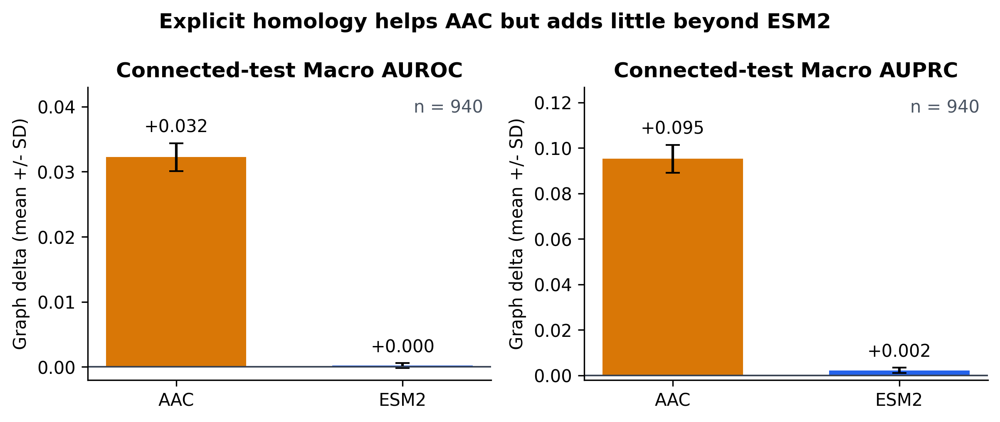
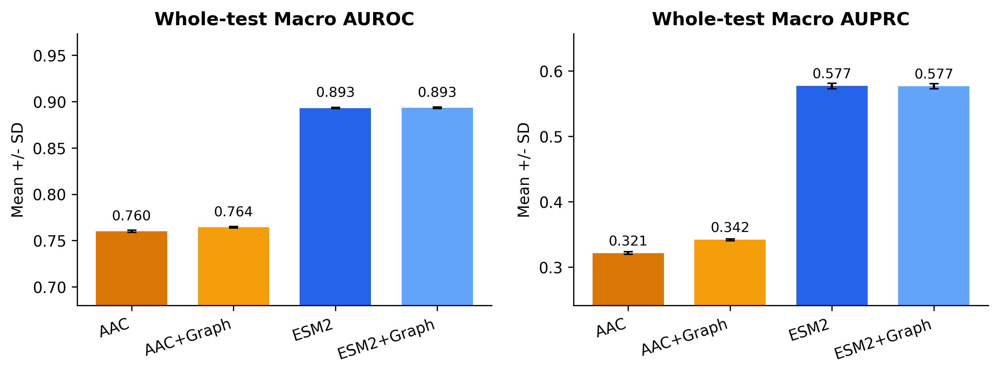
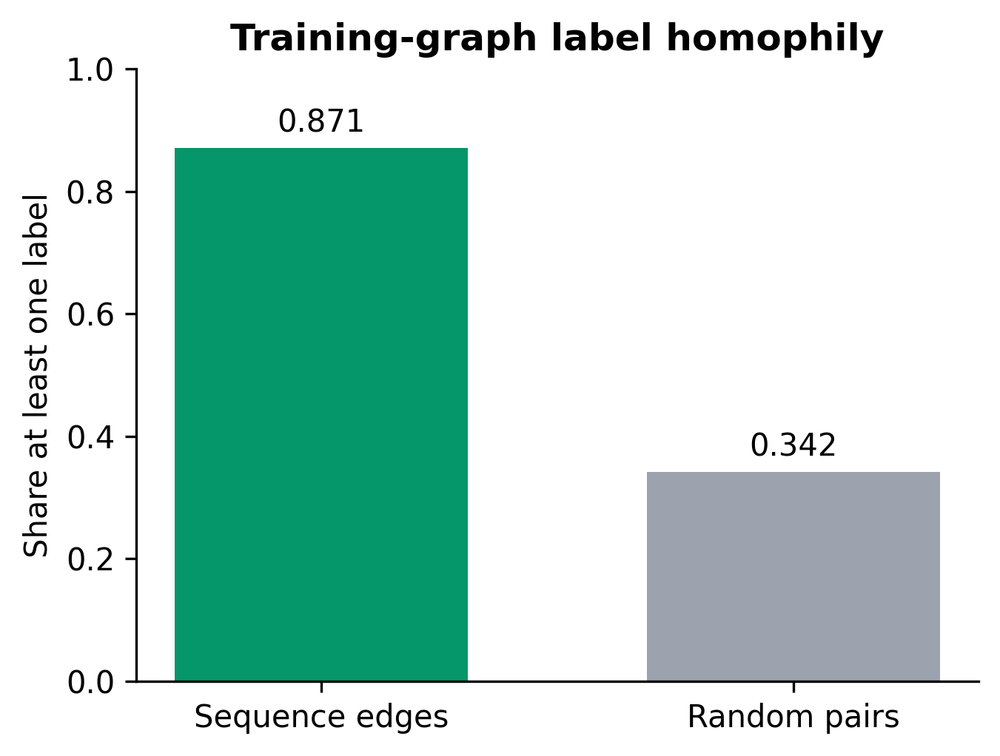
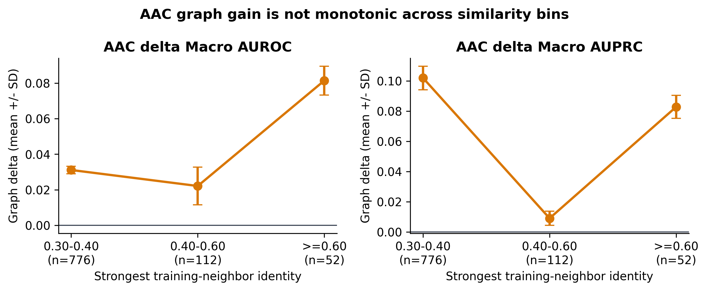

# Sequence-Aware Protein Representation Learning with ESM2 and Homology Graphs

*Can explicit sequence-similarity graphs provide predictive information beyond pretrained protein language model embeddings under homology-aware out-of-distribution evaluation?*

## Overview

This project studies multilabel protein subcellular-localization prediction on DeepLoc 2.0. It compares a weak sequence representation (20-dimensional amino-acid composition, AAC) with pretrained ESM2 embeddings, both with and without an explicit MMseqs2 sequence-similarity graph.

The evaluation is strictly inductive: validation and test proteins may aggregate only from training proteins. There is no validation-to-validation or test-to-test message passing, and a protein without a qualifying training neighbor falls back exactly to its nongraph baseline.

## Motivation

Protein language models can implicitly encode evolutionary and sequence relationships. Explicit homology graphs may nevertheless provide complementary relational information. This project isolates that contribution in a controlled localization task: does the graph still help after replacing AAC with a pretrained protein language-model representation?

Inspired by UniPert's combination of protein language-model embeddings and explicit sequence relationships, this project tests the contribution of homology information rather than attempting to reproduce UniPert.

## Dataset

- DeepLoc 2.0: 28,303 proteins.
- Eleven multilabel subcellular-localization targets.
- DeepLoc provides five homology-aware partitions. We use partitions 0-2 for training (17,145 proteins), partition 3 for validation (5,696 proteins), and partition 4 for testing (5,462 proteins).

The source CSV is available from the [DeepLoc 2.0 repository](https://github.com/teevee112/DeepLoc-2.0/blob/main/data_files/multisub_5_partitions_unique.csv). The random multilabel-stratified split retained in the processed table is not used for the main results.

## Representations

### AAC

Each protein is represented by the proportions of the 20 standard amino acids. The baseline is an MLP with architecture `20 -> 256 -> 11`.

### ESM2

Each protein is represented by a 320-dimensional mean-pooled embedding from `facebook/esm2_t6_8M_UR50D`. Sequences longer than 1,022 residues are embedded in chunks and combined by a length-weighted mean. The baseline MLP uses `320 -> 256 -> 11`.

## Sequence graph

MMseqs2 is used for all-vs-all sequence search. Self-hits are removed and an edge is retained when:

- `fident >= 0.30`;
- `min(qcov, tcov) >= 0.50`.

Each query retains at most eight training neighbors, pre-ranked by `fident * min_cov`. That score is used only for top-k selection; final neighbor importance is learned from the query, neighbor, `fident`, and `min_cov`.

## Inductive graph model

For query protein (i) and training neighbor (j), attention is computed as

\[
\alpha_{ij}=\operatorname{softmax}_j\left(\operatorname{MLP}_{attn}
([z_i\,\Vert\,z_j\,\Vert\,fident_{ij}\,\Vert\,mincov_{ij}])\right).
\]

The neighbor summary is (n_i=\sum_j\alpha_{ij}W_vz_j), and the final logits are

\[
l_i=l_i^{base}+m_i\,g([z_i\,\Vert\,n_i]),
\]

where (m_i=0) when no training neighbor is available. The baseline branch is frozen and kept in evaluation mode. The residual output layer is initialized to zero, so epoch 0 is exactly the baseline. Graph training uses only connected training proteins, and checkpoint selection uses only connected validation proteins.

## Unified training protocol

- Seeds: 42, 43, 44.
- Full budget: 50 epochs for every baseline and graph model; no patience-based termination.
- Best checkpoint: validation Macro AUROC over the complete budget.
- Independent, explicitly seeded `torch.Generator` for every shuffled DataLoader.
- AdamW, learning rate `1e-3`, weight decay `1e-4`.
- Per-label F1 thresholds selected on validation data only.
- Graph checkpoint selection uses connected validation proteins only; epoch 0 is retained if no learned correction improves it.
- Reported uncertainty is the sample standard deviation across three seeds.

Reproducibility note: the fixed full-budget protocol avoids premature stopping observed during development; only runs from the corrected protocol are reported below.

## Results

Whole-test performance, mean +/- sample SD:

| Model | Macro AUROC | Macro AUPRC | Validation-tuned Macro F1 |
|---|---:|---:|---:|
| AAC | 0.7600 +/- 0.0012 | 0.3212 +/- 0.0019 | 0.3525 +/- 0.0028 |
| AAC + Graph | **0.7645 +/- 0.0008** | **0.3416 +/- 0.0012** | **0.3745 +/- 0.0020** |
| ESM2 | 0.8930 +/- 0.0007 | **0.5769 +/- 0.0042** | **0.5591 +/- 0.0049** |
| ESM2 + Graph | **0.8932 +/- 0.0008** | 0.5765 +/- 0.0041 | 0.5589 +/- 0.0051 |

Paired graph effects (`Graph - corresponding baseline`):

| Representation | Test subset | n | Delta Macro AUROC | Delta Macro AUPRC | Delta Macro F1 |
|---|---|---:|---:|---:|---:|
| AAC | Whole test | 5,462 | **+0.0045 +/- 0.0004** | **+0.0204 +/- 0.0008** | **+0.0220 +/- 0.0022** |
| AAC | Has training neighbor | 940 | **+0.0322 +/- 0.0022** | **+0.0952 +/- 0.0061** | **+0.0869 +/- 0.0088** |
| AAC | No training neighbor | 4,522 | 0.0000 +/- 0.0000 | 0.0000 +/- 0.0000 | 0.0000 +/- 0.0000 |
| ESM2 | Whole test | 5,462 | +0.0002 +/- 0.0002 | -0.0003 +/- 0.0011 | -0.0003 +/- 0.0005 |
| ESM2 | Has training neighbor | 940 | +0.0002 +/- 0.0004 | +0.0022 +/- 0.0012 | -0.0066 +/- 0.0104 |
| ESM2 | No training neighbor | 4,522 | 0.0000 +/- 0.0000 | 0.0000 +/- 0.0000 | 0.0000 +/- 0.0000 |



### Key finding

Explicit homology substantially improves weak AAC representations when training homologs are available, but provides essentially no additional predictive benefit over ESM2. This suggests that pretrained protein language models may already encode much of the sequence-homology information captured by the explicit similarity graph.

The graph result is diluted on the complete test set because only 940 of 5,462 test proteins have a qualifying training neighbor.



## Supporting analyses

### Training-graph label homophily

Among filtered train-to-train sequence edges, 0.871 of pairs share at least one positive localization label, compared with 0.342 for an equally sized seeded sample of random training pairs. This shows that the graph contains task-relevant structure; it does not mean that 87.1% of homologous proteins have identical localization.



### Similarity bins

AAC graph effects grouped by the strongest available training-neighbor identity:

| Strongest `fident` | n | Delta Macro AUROC | Delta Macro AUPRC |
|---|---:|---:|---:|
| 0.30-0.40 | 776 | +0.0311 +/- 0.0021 | +0.1019 +/- 0.0078 |
| 0.40-0.60 | 112 | +0.0221 +/- 0.0106 | +0.0091 +/- 0.0046 |
| >=0.60 | 52 | +0.0815 +/- 0.0081 | +0.0828 +/- 0.0076 |

Explicit homology consistently improves weak AAC representations, with particularly large Macro-AUROC gains among proteins having very strong training homologs. The gain is not monotonic across similarity bins, and the higher-similarity bins contain relatively few proteins.



## Reproducibility

Create the environment on the E: drive:

```powershell
conda env create --prefix E:\z_data\protein-representation-ood\.conda\envs\protein-ood --file environment.yml
conda activate E:\z_data\protein-representation-ood\.conda\envs\protein-ood
```

Download the DeepLoc table and prepare the processed data:

```powershell
curl.exe -L "https://raw.githubusercontent.com/teevee112/DeepLoc-2.0/main/data_files/multisub_5_partitions_unique.csv" -o data\raw\multisub_5_partitions_unique.csv
python scripts\prepare_data.py
python scripts\export_fasta.py
python scripts\extract_esm_embeddings.py
```

Run MMseqs2 inside WSL2/Ubuntu. The project stays on the Windows E: drive:

```bash
cd /mnt/e/z_data/protein-representation-ood
mmseqs easy-search \
  data/processed/deeploc_sequences.fasta \
  data/processed/deeploc_sequences.fasta \
  data/mmseqs/all_vs_all.tsv \
  /tmp/mmseqs2-deeploc \
  --alignment-mode 3 \
  --max-seqs 100 \
  -s 7.0 \
  --format-output "query,target,fident,alnlen,qcov,tcov,evalue,bits" \
  --threads 8
```

Run the final experiment and regenerate every figure from the saved CSV/JSON outputs:

```powershell
python scripts\build_graph.py
python scripts\run_multiseed.py
python scripts\make_figures.py
python scripts\validate_results.py
```

The main experiment does not depend on executing the sandbox notebook.

## Repository structure

```text
protein-representation-ood/
|-- README.md
|-- environment.yml
|-- configs/
|   `-- default.yaml
|-- data/
|   |-- raw/
|   |-- processed/
|   |-- mmseqs/
|   `-- example/
|-- notebooks/
|   |-- 00_sandbox.ipynb
|   |-- 01_data_and_representation_sanity.ipynb
|   `-- 02_result_analysis.ipynb
|-- src/
|   |-- data.py
|   |-- embeddings.py
|   |-- graph.py
|   |-- models.py
|   |-- train.py
|   |-- evaluate.py
|   |-- experiment.py
|   `-- utils.py
|-- scripts/
|   |-- prepare_data.py
|   |-- export_fasta.py
|   |-- extract_esm_embeddings.py
|   |-- build_graph.py
|   |-- run_multiseed.py
|   |-- make_figures.py
|   `-- validate_results.py
`-- results/
    |-- tables/
    |-- metrics/
    |-- figures/
    `-- checkpoints/       # generated locally; git-ignored
```

## Limitations

- The study evaluates one downstream task and one dataset.
- The ESM2 model is the small 8M-parameter variant; conclusions may differ for other pretrained representations.
- Graph connectivity depends on fixed identity and coverage thresholds.
- Only 17.2% of homology-aware test proteins have a qualifying training neighbor.
- Sequence homology is not equivalent to biological function or identical localization.
- The fixed 50-epoch budget is reproducible, but AAC validation performance was still improving near the end of some runs; a different predeclared budget may change absolute AAC scores.
- The findings should not be generalized to all protein tasks without further evaluation.
